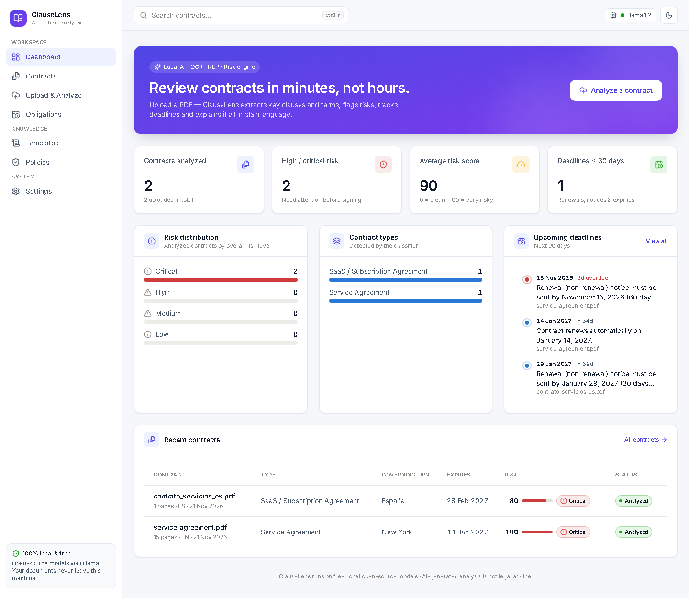
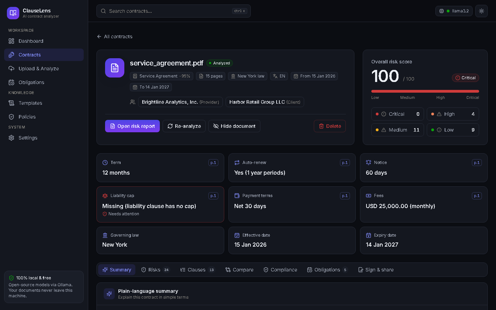
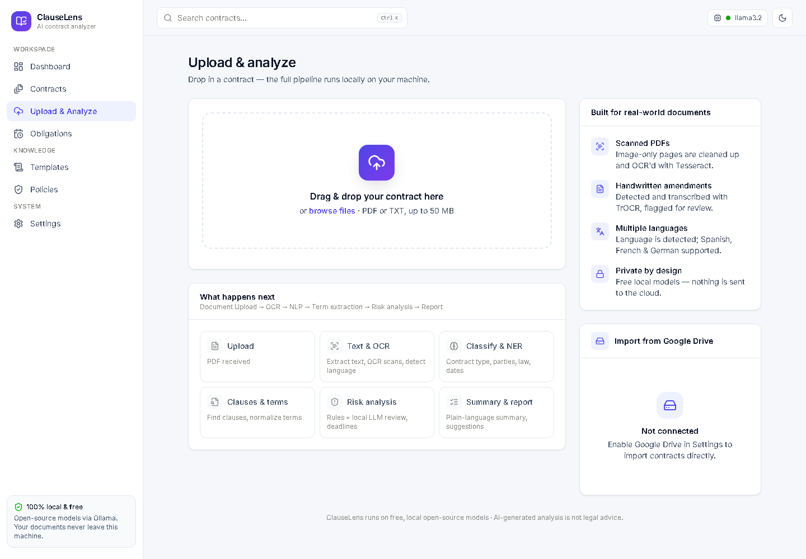

# ClauseLens: AI Contract Analyzer



| Contract analysis (dark mode) | Upload & pipeline |
|---|---|
|  |  |

Upload a contract PDF and get a full review in about a minute:

| Feature | Example output |
|---|---|
| **Clause extraction** | Termination, liability, indemnification, confidentiality, renewal, payment, IP, data protection… with page references |
| **Key-term normalization** | `Term: 12 months · Auto-renew: Yes · Notice: 60 days · Liability cap: Missing` |
| **Risk flagging + score** | "Liability cap is missing — standard is 1x fees", "This indemnification clause is unusually broad" → 82/100 |
| **Plain-language summary** | "This is a 15-page Service Agreement between … It lasts 12 months and renews automatically…" |
| **Template comparison** | Clause-by-clause diff and term table vs. your standard template |
| **Compliance checking** | "Does this contract comply with our data privacy policy?" — pass / fail / needs review per requirement |
| **Obligation tracking & expiry alerts** | "Renewal notice must be sent by November 15, 2026", "This contract expires in 30 days" |
| **Negotiation suggestions** | "Consider asking for a cap on liability equal to 12 months of fees" |
| **Accounts & roles** | Login/register, user side (own contracts only) and admin side (org overview, user management, all contracts) |
| **Integrations (optional)** | Google Drive import/export · DocuSign, Dropbox Sign (HelloSign), Adobe Sign e-signature |

**100% free and open source.** The AI runs locally through [Ollama](https://ollama.com). There are no paid APIs and no API keys, and your contracts never leave your machine.

> ⚠️ AI-generated analysis is not legal advice. Have a qualified lawyer review important contracts.

## How it works

```
Upload → Ingest (PyMuPDF) → OCR for scanned pages (Tesseract + OpenCV) → handwriting (TrOCR, optional)
      → Language detection → Contract-type classification → Legal entity recognition
      → Section segmentation → Clause extraction → Term extraction & normalization
      → Risk analysis (YAML rules + local LLM review) → Obligations & deadlines → Summary + report
```

**Hybrid design.** Code you can verify does most of the work:
- regex and dateparser normalization
- [YAML risk rules](backend/app/rules/risk_rules.yaml)
- a [negotiation playbook](backend/app/rules/playbook.yaml)
- difflib comparison

The local LLM handles the parts that need judgment: classifying ambiguous sections, spotting unusual wording, writing the summary, and giving advice. It gets small, schema-constrained prompts, and its JSON output is validated. If Ollama isn't running, everything still works with rule-based logic, and the UI tells you so.

## Tech stack (all free)

| Layer | Tech |
|---|---|
| Backend | Python 3.11+, FastAPI, SQLAlchemy + SQLite, APScheduler, in-process job queue |
| LLM | Ollama. Default `qwen2.5:7b-instruct`; fallback `llama3.2:3b`; embeddings `nomic-embed-text` |
| Documents / OCR | PyMuPDF, Tesseract, OpenCV, TrOCR (handwriting, optional) |
| NLP | Rules + optional spaCy and lingua |
| Frontend | React 18, Vite, TypeScript, Tailwind, TanStack Query |

## Setup (Windows)

1. **Ollama (the LLM)**: install from https://ollama.com/download, then:
   ```
   ollama pull qwen2.5:7b-instruct
   ollama pull nomic-embed-text
   ```
   7B models need about 8 GB RAM. On smaller machines, use `llama3.2:3b` and set `OLLAMA_MODEL` to match.
2. **Tesseract OCR** (needed for scanned PDFs): install the UB Mannheim build from https://github.com/UB-Mannheim/tesseract/wiki, then set `TESSERACT_CMD` in `.env`. Tick the extra language packs if you need them.
3. **Config**: `copy .env.example .env`
4. **Backend**
   ```
   cd backend
   python -m venv .venv
   .venv\Scripts\activate
   pip install -e ".[dev]"
   # optional extras:
   #   pip install -e ".[nlp]"      spaCy + lingua (better entities / language detection)
   #   pip install -e ".[vision]"   OpenCV + TrOCR (scan clean-up, handwriting; ~2 GB)
   uvicorn app.main:app --reload
   ```
   API docs: http://localhost:8000/docs
5. **Frontend** (in a second terminal)
   ```
   cd frontend
   npm install
   npm run dev
   ```
   App: http://localhost:5173. If that port is taken, Vite picks the next free one; set `FRONTEND_URL` to match if you use the OAuth integrations.
6. **Try it with sample contracts**
   ```
   cd backend
   python scripts/make_samples.py
   ```
   This writes three synthetic PDFs to `samples/` (gitignored): a 15-page service agreement, a scanned copy of it, and a Spanish contract. Upload them on the Upload page.

## Tests

```
cd backend
pytest -m "not ollama"   # fast, offline, uses the mock LLM (what CI runs)
pytest -m ollama         # integration tests against your local Ollama
ruff check . && ruff format --check .
cd ../frontend && npm run lint && npm run build
```

## Customizing

- **Risk rules**: edit [backend/app/rules/risk_rules.yaml](backend/app/rules/risk_rules.yaml). Condition kinds are documented at the top of the file.
- **Negotiation playbook**: [backend/app/rules/playbook.yaml](backend/app/rules/playbook.yaml)
- **Templates**: the Templates page (upload a PDF or paste text). The repo seeds [templates/standard_service_agreement.md](templates/standard_service_agreement.md).
- **Compliance policies**: the Policies page. A sample data-privacy policy is seeded from [sample_privacy_policy.yaml](backend/app/rules/sample_privacy_policy.yaml).
- **Prompts**: [backend/app/pipeline/prompts.py](backend/app/pipeline/prompts.py)

## Optional integrations

DocuSign, Dropbox Sign (HelloSign), Adobe Acrobat Sign and Google Drive are **off by default**, and this project only uses their **free developer sandbox / test modes**. To enable one, set its `ENABLE_*` flag and developer credentials in `.env`, along with a `FERNET_KEY` (OAuth tokens are stored encrypted). Then connect it on the Settings page. Production use of the e-signature APIs requires paid plans from those vendors, and this project does not use them.

Status updates come from polling: press "Refresh" on a signature request. When a request is completed, the signed PDF is pulled back in and re-analyzed automatically.

## Edge cases

| Case | Handling |
|---|---|
| Scanned documents | Pages with no text layer are rendered at 300 dpi, deskewed, denoised and binarized, then OCR'd. A confidence score is kept for each page, and pages below 60% get a warning. |
| Handwritten amendments | OCR lines with low confidence on scanned pages go through TrOCR (local) when the `vision` extra is installed. Their text is appended as "[Handwritten amendment]", and the affected clauses are marked **needs review**. |
| Multiple languages | Language is detected per document, and Spanish/French/German keywords are handled in the rules. For OCR, set `OCR_LANGUAGES=eng+spa+…`. Qwen2.5 extracts in many languages and writes the summary in the document's language. |

## Project layout

```
backend/
  app/
    api/            REST endpoints (contracts, analysis, obligations, integrations)
    pipeline/       ingest, ocr, handwriting, language, sections, classify, entities,
                    clauses, terms, normalize, risk, obligations, summarize, negotiate,
                    compare, compliance, orchestrator
    llm/            provider interface + Ollama + mock
    integrations/   gdrive, docusign, dropbox_sign, adobe_sign, oauth, encrypted credentials
    rules/          risk rules, playbook, sample policy (YAML)
  scripts/          make_samples.py
  tests/            pytest suite (synthetic fixtures only)
frontend/src/       pages (Dashboard, Upload, ContractDetail, Obligations, Templates, Policies, Settings)
templates/          standard contract templates (seeded on first run)
storage/            uploaded files at runtime (gitignored)
```

## Roadmap

- [x] Phase 0: repo bootstrap, CI, pre-commit
- [x] Phase 1: core analysis (upload → OCR → extraction → risk → summary → report)
- [x] Phase 2: template comparison, compliance, obligations and alerts, negotiation suggestions
- [x] Phase 3: Google Drive and e-signature integrations (sandbox)
- [x] Phase 4: scanned / handwritten / multi-language handling
- [ ] Next: webhooks for e-sign status, email alert notifier, clause highlighting inside the PDF viewer, user accounts

## License

MIT
